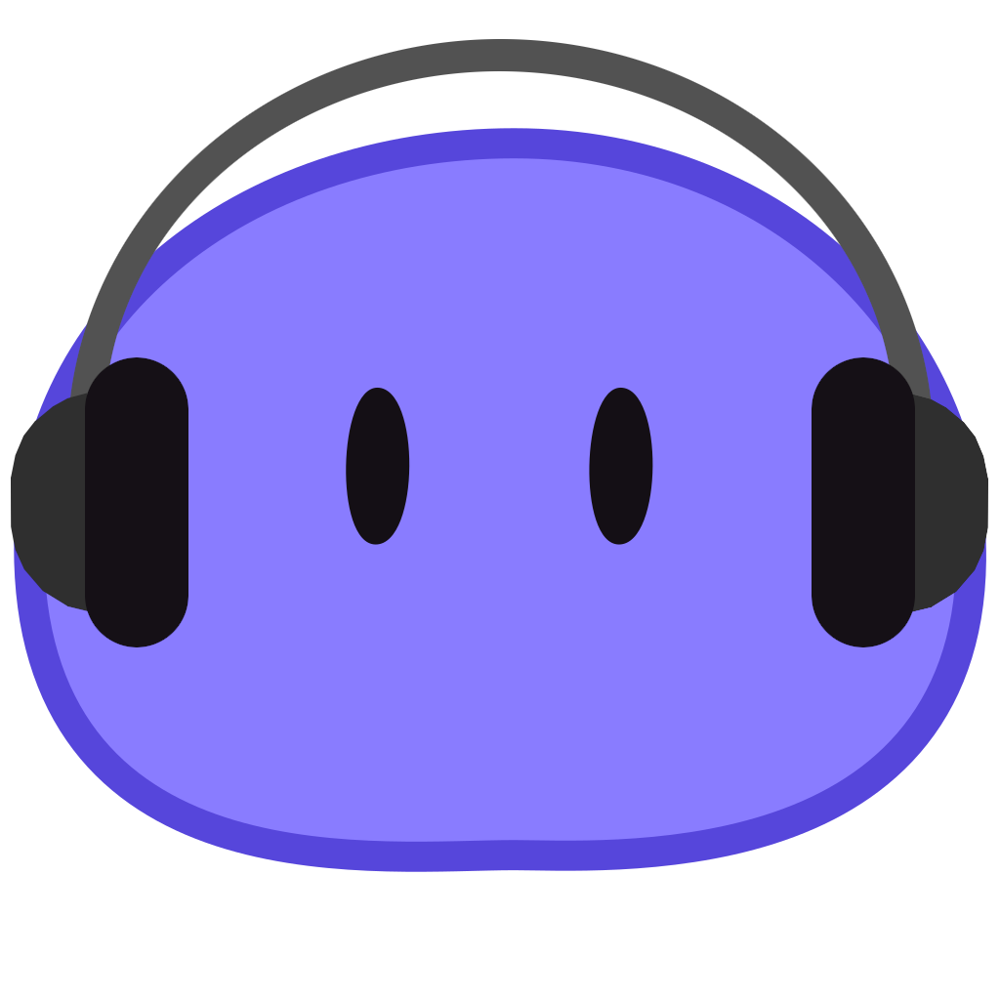

<div align="center">



[](https://opensource.org/licenses/MIT)


</div>

---

**dango-music** is a lightweight, self-hosted Node.js application built for listening to radio and YT Music.

## Run

```
pnpm install
run.bat          # Windows
./run.sh         # macOS / Linux
```

Menu: `1` development (hot reload), `2` production. Or `run.bat dev` /
`run.bat prod`. Production builds on first launch.

## Controls

`Ctrl+R` show/hide · `Ctrl+Shift+Q` quit · `Space` play/pause ·
`↑` `↓` volume · `←` `→` previous/next · drag the header to move

## Config

To change the port, create a `.env` in this folder — the project root, next to
`run.bat`:

```ini
DANGO_MUSIC_PORT=3000
```

If that port is taken it uses the next free one instead and logs which.

Set your own Discord application by adding `DISCORD_CLIENT_ID` to the same
file. A `.env` in `~/.dango-music/` also works and takes priority.

## YouTube Music

Public search and playback need no sign-in. For your library, paste your cookie
into the overlay — copy the whole `Cookie` header from DevTools → Network on
`music.youtube.com`. Don't copy from the wrapped preview, it truncates.

Stored at `~/.dango-music/ytmusic_cookie.txt`.

## Dev

```
pnpm run dev
pnpm run build
pnpm run lint
```

## License

Distributed under the terms of the [MIT License](LICENSE).
